<div align="center">

# TaskPilot

### The AI co-pilot for your day

A keyboard-first task manager that works offline. Type a task the way you'd say it, let the co-pilot time-block your calendar, then work through it in focus sessions. Your tasks never leave your browser.

**[taskpilot.ewstudios.workers.dev](https://taskpilot.ewstudios.workers.dev)** · [The shared API](https://github.com/emwil23/ew-apps-api)


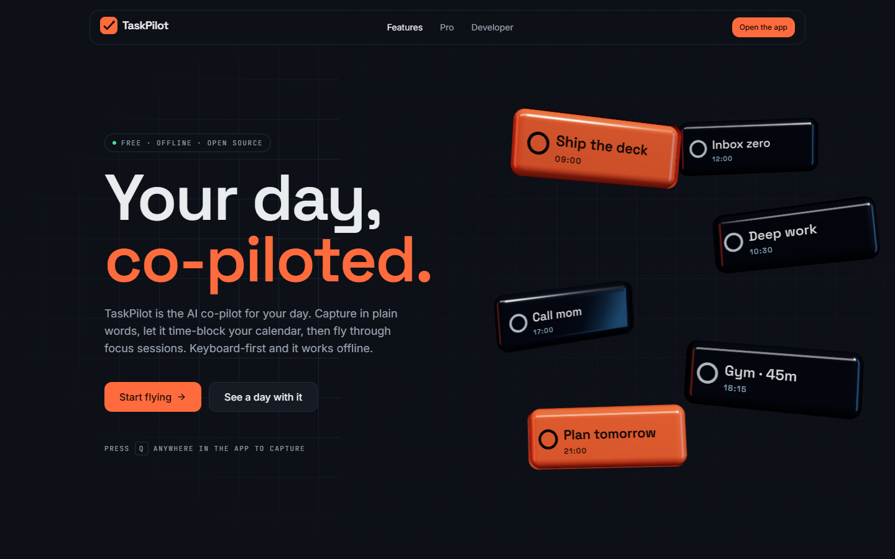

</div>

## The idea

TaskPilot began in 2021 as a tutorial-sized React app: a form, four tabs and `localStorage`. It indexed tasks by `id - 1`, showed the wrong month, and reversed the stored list every time it rendered. This is a rebuild of it as a real product.

The best idea from each well-known task app is borrowed and fitted into one calm app:

| From              | What TaskPilot takes                                   |
| :---------------- | :----------------------------------------------------- |
| Todoist           | Natural-language quick add, parsed on the device       |
| Things 3          | Inbox · Today · Upcoming · Someday, and a quiet design |
| Linear and Trello | Ctrl+K for everything, J/K/X keys, a kanban board      |
| TickTick          | Pomodoro focus, an Eisenhower matrix, habit streaks    |
| Motion            | "Plan my day": AI time-blocking on a calendar          |
| Sunsama           | A morning planning ritual and an evening review        |
| Akiflow           | Capture from anywhere, including by voice              |

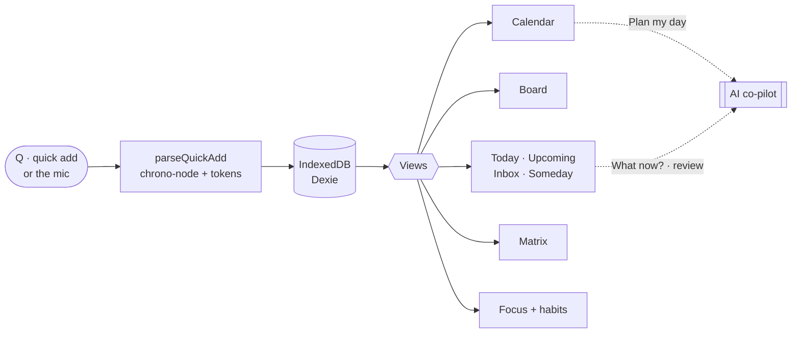

## A walk through

|                                                                                                                                                                                                               |                                                                                                                                                                                               |
| :------------------------------------------------------------------------------------------------------------------------------------------------------------------------------------------------------------ | :-------------------------------------------------------------------------------------------------------------------------------------------------------------------------------------------- |
| 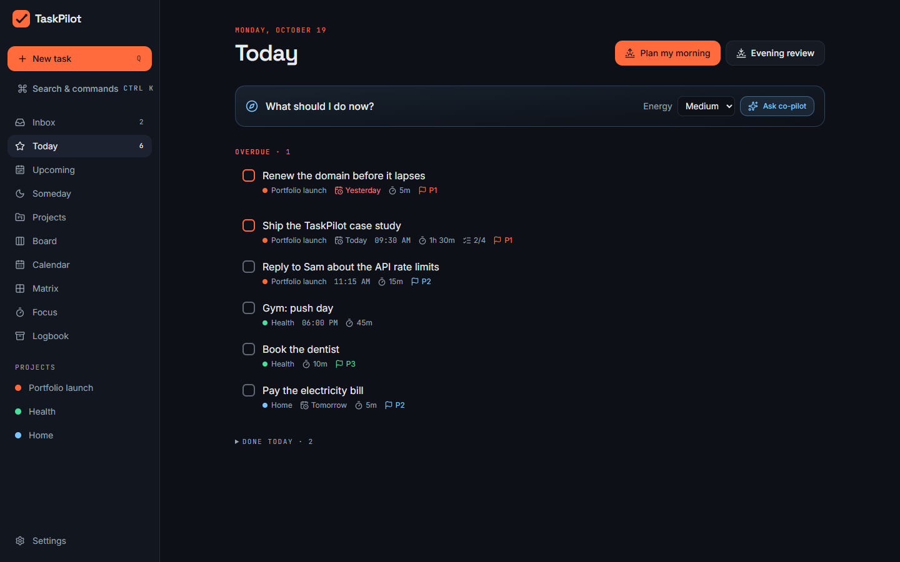                          | 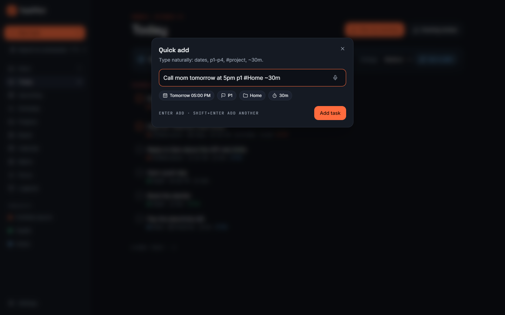               |
| **Today.** Overdue work first, then the day. The co-pilot card picks one task for your energy level and says why.                                                                                             | **Type it like you'd say it.** Dates, `p1`–`p4`, `#project` and `~30m` turn into chips as you type. Shift+Enter adds another; the mic uses the Web Speech API.                                |
| 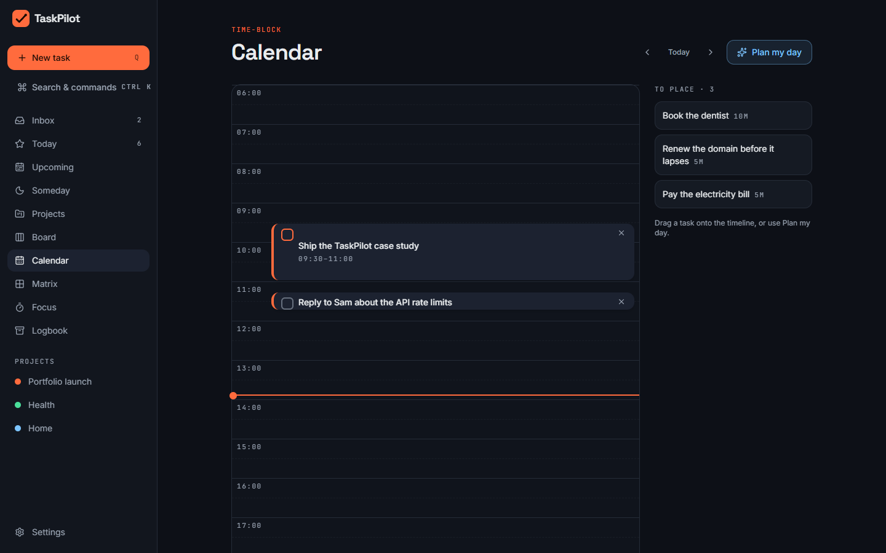 | 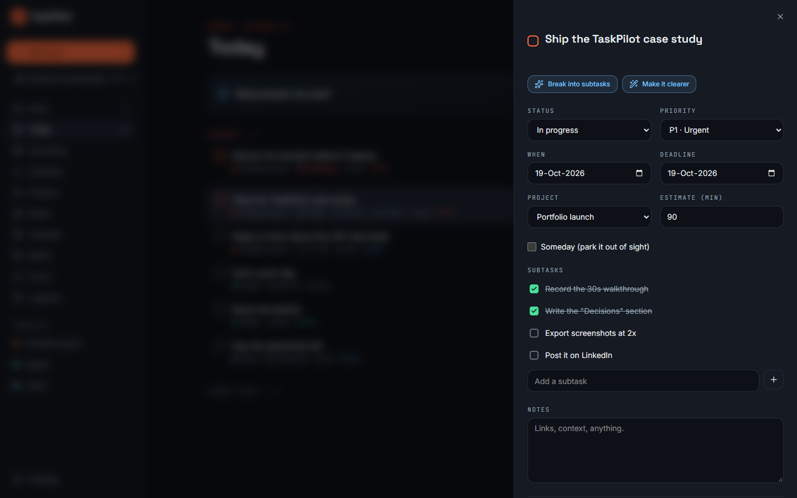 |
| **Time-block the day.** Drag tasks onto the timeline, or press Plan my day and the co-pilot fills the gaps around what's already there.                                                                       | **Every task opens into a sheet.** The co-pilot can break a goal into subtasks with estimates, or rewrite a vague task into a first step. Each change can be undone.                          |
| 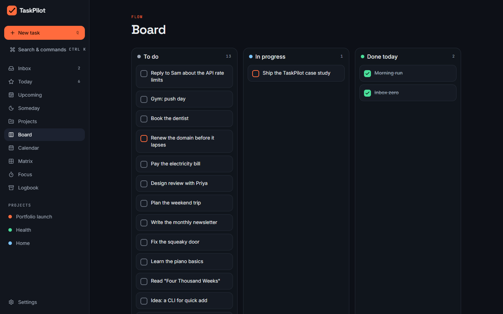                                                                                                                | 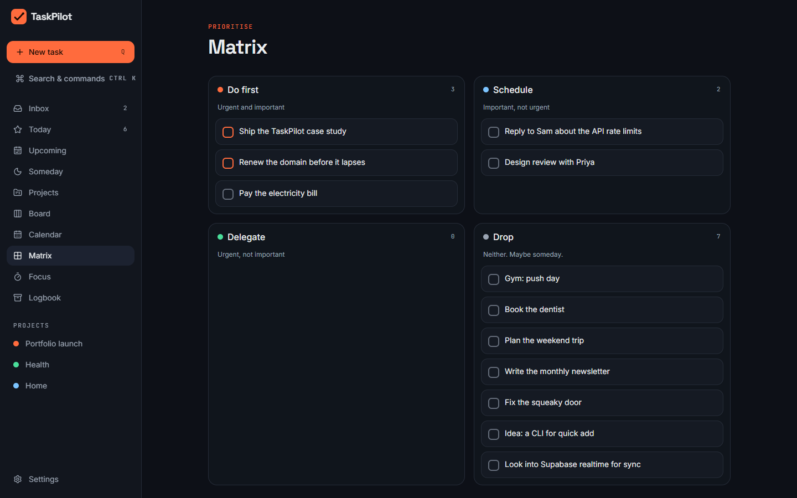                                                                            |
| **Board.** Drag by mouse, touch, or keyboard: Space lifts a card, the arrows jump it to the next column, Space drops it.                                                                                      | **Matrix.** Quadrants come from priority and deadline until you drag a task somewhere else.                                                                                                   |
| 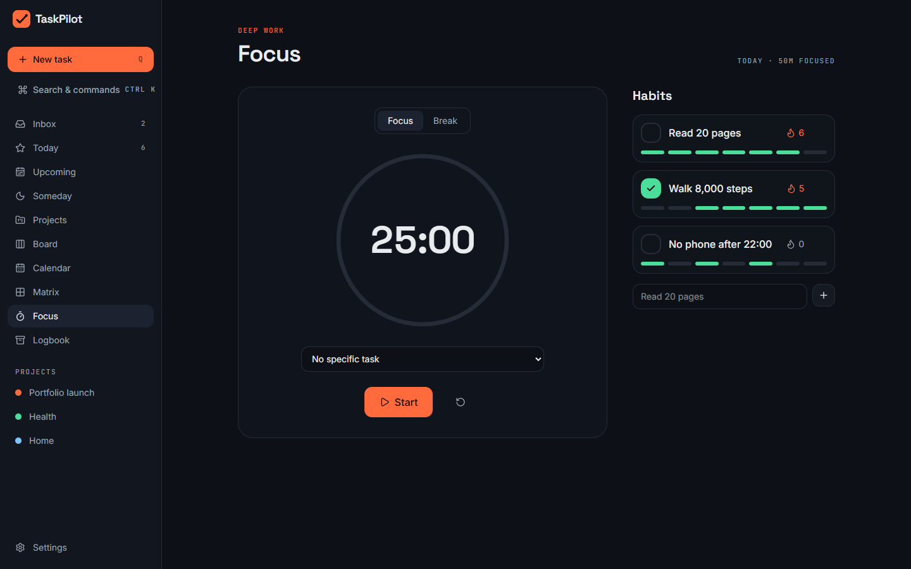                                                                       | 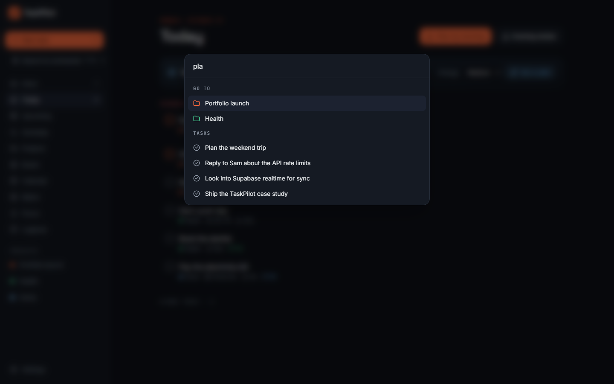                                                                   |
| **Focus.** Pomodoro rounds tied to a task, logged per day, with habit streaks beside them.                                                                                                                    | **Ctrl+K.** Every view, project, task and command, by keyboard. Press `?` for the full list of shortcuts.                                                                                     |
| 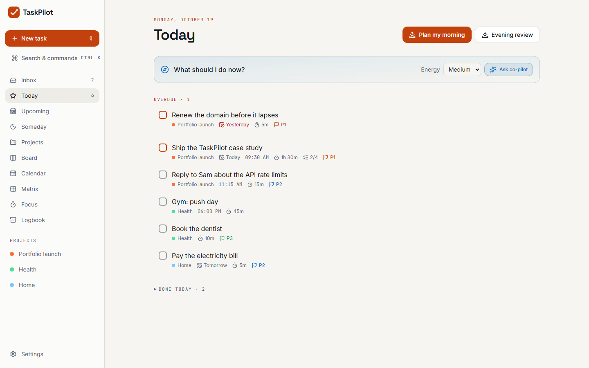                                                                                                              | 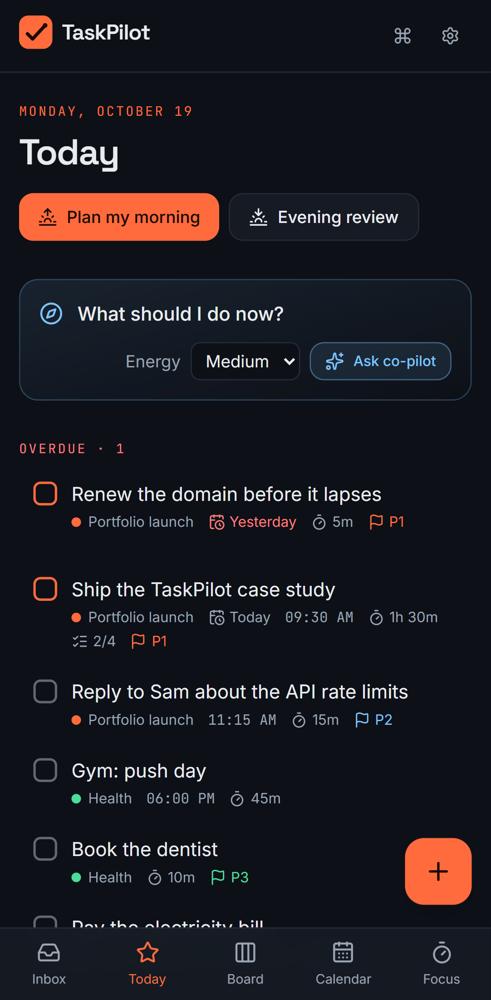                                                      |
| **Light theme.** Both themes pass WCAG AA on every page, checked by axe in CI.                                                                                                                                | **Phone.** A bottom tab bar and a floating add button; installable as a PWA.                                                                                                                  |

The landing page tells the same story as a pinned scroll "flight path", from first coffee to lights out:

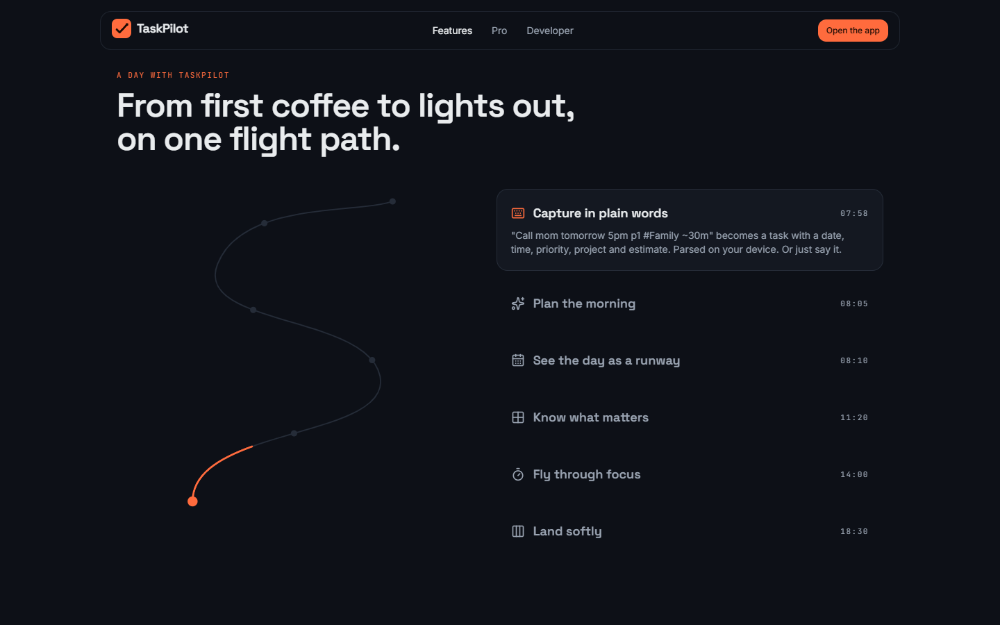

## How it is built

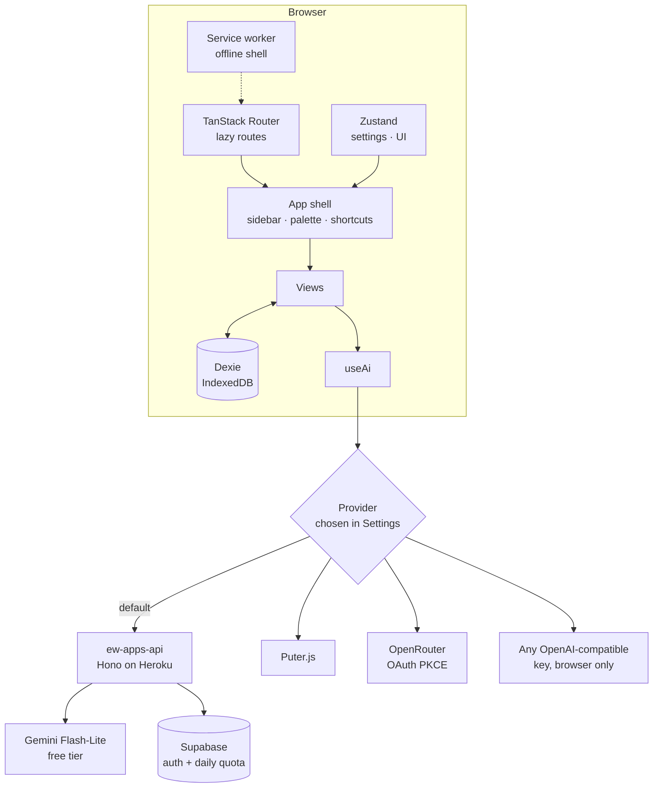

Every AI action streams JSON Lines, so a list of subtasks or time blocks appears item by item:

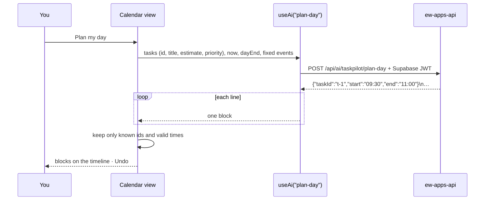

The public pages are prerendered and then hydrated, so the first paint never waits for JavaScript:

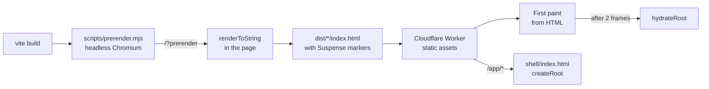

## Decisions worth explaining

- **Local-first, no account.** Tasks live in IndexedDB. Nothing to sign up for, nothing to leak, and it works offline. Export and import are plain JSON. Sync is a Pro feature for later, built on the same model.
- **The AI is never paywalled, and you choose who runs it.** The free server uses Gemini's free tier through [ew-apps-api](https://github.com/emwil23/ew-apps-api). Prompt templates live on the server, which accepts only typed, size-capped data, never a raw prompt. If you'd rather not use it, or you're in the EEA, the UK or Switzerland where the free tier isn't allowed, Puter, OpenRouter (PKCE, no key copying) or your own key work from the browser.
- **The AI sees as little as possible.** Titles, estimates, priorities and dates. Never notes or project names. The privacy page says plainly that Google may read free-tier prompts.
- **Prerender and hydrate, not a server framework.** Rendering the public pages with React's own `renderToString`, inside the built app in a headless browser, gives correct hydration markers without Next.js or a server. Mobile Lighthouse went from 0.79 to 0.98 on the landing page.
- **3D only where it helps.** The glass tiles are React Three Fiber, loaded after first paint, on wide screens, and never on a software GPU (headless Chrome, some VMs), where they would burn the CPU for decoration. The canvas stops rendering once it scrolls out of view.
- **Keyboard drag for everyone.** dnd-kit's default keyboard sensor nudges a card a few pixels per press. A small coordinate getter jumps it to the next drop zone instead, so the board, matrix and calendar all work without a mouse.
- **A quadrant is derived until you set it.** Urgent means due by tomorrow; important means P1 or P2. Dragging in the matrix stores an override, so the view never fights you.
- **Clips play only when seen.** Videos use `preload="none"`, play while on screen, and stay still with reduced motion. The service worker doesn't precache them.

## How it was made

Built in conversation with [Claude Code](https://claude.com/claude-code), which wrote and tested the code. The design direction came from Awwwards references (Butter, Heron AI, Overworld Audio, Lidar Drone Scanning; see [docs/design-brief.md](docs/design-brief.md)). The art and clips were generated in Google Flow (Nano Banana Pro and Omni 1.1 Flash); [docs/assets.md](docs/assets.md) lists every prompt. The logo and icons are SVG.

## Run it

```bash
npm install
```

```bash
npm run dev
```

```bash
npm test
```

```bash
npm run e2e
```

Node 24. Copy `.env.example` to `.env` to point at the shared API and Supabase; without them, the app runs fully offline and offers the other AI providers. `npm run build` also prerenders the public pages, so it needs Playwright's Chromium (`npx playwright install chromium`). `npm run e2e` builds and serves the app with the same routing as the live Worker (`serve.json` mirrors `public/_redirects`) and runs the flows, plus axe on every page in both themes. CI adds lint, typecheck and Lighthouse (≥ 0.95 on every category). Deploy with `npm run build && npx wrangler deploy` (config in `wrangler.jsonc`).

`node scripts/screenshots.mjs` retakes the pictures in `docs/` with sample data, against a running build on port 4173.

## Where things are

```
src/
├─ main.tsx              router.load(), then hydrate or render
├─ router.tsx            every route, lazily loaded
├─ index.css             design tokens for both themes
├─ lib/                  model and logic: db, quickAdd, tasks, dates, backup, dndKeyboard
├─ ai/                   actions + templates, providers, JSON Lines, PKCE, Supabase sign-in
├─ stores/               settings (persisted) and UI state
├─ hooks/                live queries and keyboard shortcuts
├─ components/           app shell, quick add, palette, task detail, board, onboarding
├─ views/                Today, lists, Board, Calendar, Matrix, Focus, Projects, rituals
├─ landing/              3D hero, flight-path scroll, smooth scroll
└─ pages/                Landing, Developer, Pro, Settings, Privacy, Terms, 404
scripts/
├─ prerender.mjs         static HTML for the public pages
└─ screenshots.mjs       the README pictures
e2e/                     Playwright flows and axe checks
docs/                    design brief, asset list, screenshots
```

<div align="center">Made with ♥ by EWSTUDIOS</div>
